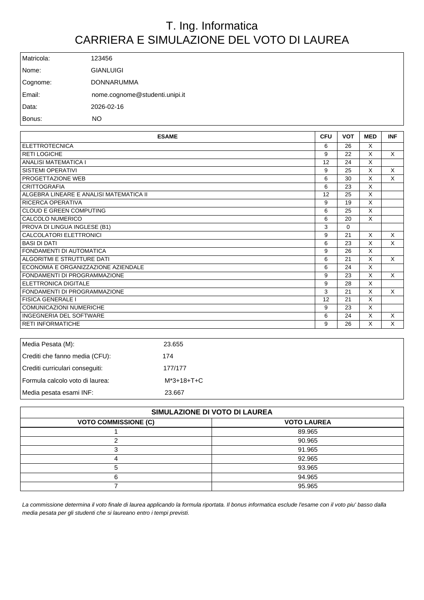

# Laureandosi

Progetto universitario di **Ingegneria del Software — Università di Pisa** per la preparazione dei prospetti di laurea.

L'applicazione legge carriere e anagrafiche da un dataset JSON dimostrativo, calcola gli indicatori previsti per ogni corso di laurea e genera i documenti PDF per studenti e commissione.

## Funzionalità

- Calcolo di medie pesate, crediti e bonus per Ingegneria Informatica.
- Generazione dei prospetti individuali e del documento della commissione con simulazioni del voto.
- Configurazione di formule, filtri degli esami e contenuto delle email.
- Invio dei prospetti tramite PHPMailer e la funzione `mail()` di PHP.
- Test automatici dei calcoli, dei PDF e degli endpoint.

## Un esempio di output

La seconda pagina del prospetto della commissione mostra carriera, indicatori e simulazione del voto. Cliccando sull'anteprima si apre il PDF completo.

[](docs/esempi/prospetto-commissione.pdf)

## Struttura

```text
docs/
├── documentazione.pdf       Relazione del progetto
├── modello.vpp              Modello UML per Visual Paradigm
└── esempi/                  PDF dimostrativo e anteprima
sorgente/
├── classi/                  Entity, Boundary e Control
├── config/                  Formule, corsi e percorsi applicativi
├── data/                    Anagrafiche e carriere dimostrative
├── lib/                     FPDF e PHPMailer, con le loro licenze
├── test/                    Suite automatica e fixture JSON
├── wordpress-snippets/      Adattamento delle pagine per WordPress
├── index.php                Generazione, visualizzazione e invio
├── indexCONF.php            Configurazione
├── indexTEST.php            Risultati dei test nel browser
└── API.php                  Accesso alle operazioni applicative
```

La logica dei calcoli è nelle classi di carriera; i gestori coordinano la generazione e l'invio; le classi Boundary leggono i dati e gestiscono i percorsi. Gli endpoint HTTP delegano a queste classi. Formule e dataset rimangono separati dal codice.

## Avvio locale

Serve **PHP 8.2** con le estensioni `ctype` e `iconv`. Le librerie sono incluse: non occorre installare pacchetti con Composer.

Dalla cartella del repository:

```bash
cd sorgente
LAUREANDOSI_BASE_URL= php -S 127.0.0.1:8000
```

Aprire [la pagina principale](http://127.0.0.1:8000/), [la configurazione](http://127.0.0.1:8000/indexCONF.php) o [i test](http://127.0.0.1:8000/indexTEST.php).

Per una prima prova scegliere **T. Ing. Informatica**, inserire le matricole `123456 345678` e la data `2023-04-01`, quindi generare i prospetti. I PDF vengono creati in `sorgente/data/pdf_generati/`; questa cartella e lo stato dell'ultimo invio sono esclusi da Git.

L'invio email richiede un servizio di posta locale configurato per `mail()`: il server PHP da solo non basta. I test non inviano messaggi.

## Test

Dalla cartella del repository:

```bash
php sorgente/test/run.php
```

Il comando restituisce codice di uscita `0` se tutte le verifiche passano e `1` in presenza di fallimenti. Include prove degli endpoint in processi PHP separati, che richiedono `proc_open` abilitato. La pagina `indexTEST.php` esegue gli stessi test delle classi e dei PDF, senza le prove dei sottoprocessi CLI.

Entrambe le modalità usano una directory temporanea e la rimuovono al termine, senza sovrascrivere i PDF generati dall'applicazione.

Se PHP è installato tramite XAMPP ma non è nel `PATH`, su Linux il comando equivalente è:

```bash
/opt/lampp/bin/php sorgente/test/run.php
```

## Configurazione e WordPress

I corsi supportati e le formule sono in `sorgente/config/formule_laurea.json`; gli esami informatici sono in `esami_informatici.json`. I selettori delle pagine ricavano i corsi da questa configurazione. Cybersecurity è presente nel dataset come caso di corso non supportato.

`sorgente/config/app.php` centralizza i percorsi. `LAUREANDOSI_BASE_URL` indica il prefisso pubblico, con valore predefinito `/laureandosi`; il valore vuoto usato nell'avvio locale serve l'applicazione alla radice. `LAUREANDOSI_RUNTIME_DIR` cambia la directory dei risultati e dello stato di invio: i test la impostano automaticamente. Se la si cambia per un'installazione web, occorre anche rendere raggiungibili i PDF tramite il relativo URL pubblico.

Il progetto conserva gli snippet previsti per l'integrazione didattica con WordPress. Si aspettano il codice in `laureandosi/` sotto il tema attivo e richiamano azioni AJAX `laureandosi_*`. **I gestori di queste azioni non sono inclusi:** gli snippet documentano l'adattamento esistente, ma non costituiscono un plugin WordPress completo e installabile.

## Ambito del progetto

Questo repository presenta un prototipo didattico per esecuzione locale. Non implementa autenticazione, autorizzazioni o protezione CSRF e non è predisposto per l'uso con dati personali reali su un server pubblico. Il backend simula il sistema di ateneo tramite file locali.

Le licenze delle librerie terze sono conservate nelle rispettive cartelle `lib/PHPMailer/` e `lib/fpdf184/`.
